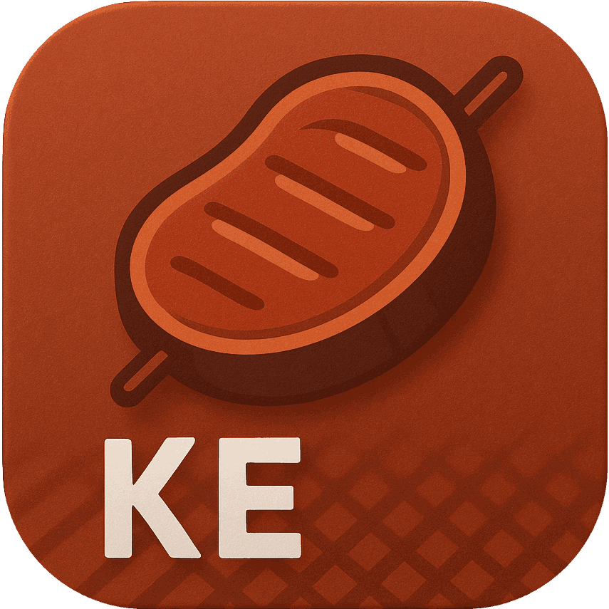

<p align="center"></p>
<p align="center">
    <a href="https://github.com/maiyun/kebab/blob/main/LICENSE">
        
    </a>
    <a href="https://www.npmjs.com/package/@maiyunnet/kebab">
        
    </a>
    <a href="https://github.com/maiyun/kebab/releases">
        
    </a>
    <a href="https://github.com/maiyun/kebab/issues">
        
    </a>
</p>

简单，易用，功能完整开袋即食的 Node.js 框架。

> 项目声明：本项目于 2019 年 2 月 25 日首次提交到 GitHub（前身 Mutton 框架于 2015 年 7 月 13 日首次提交，且在提交前已开发数年），于 2026 年正式引入 AI 进行辅助开发并进行 AI 适配改造，但项目依然是软件工程师主导、审查、验证与测试，并非许愿式 AI 自动生成。非中文部分借助柏软翻译进行辅助翻译，因此语气可能会有 AI 感。

> GitHub 的发行版本可能不全，2.0.0 之后的版本以 NPM 为准：[NPM](https://www.npmjs.com/package/@maiyunnet/kebab?activeTab=versions)

## 语言

[繁體中文](README.tc.md) | [English](../README.md)

## 环境

Node.js 24+

## 安装

执行 `npm i @maiyunnet/kebab` 安装最新版，安装后，执行 `npx kebab init` 进行初始化，然后执行 `npx kebab` 启动项目。

也可以使用 pm2 启动项目，执行 `pm2 start npx --name "kebab" -- kebab` 即可。

## 库

Ai, Buffer, Captcha, Consistent, Cookie, Core, Cron, Crypto, Db (MySQL, PostgreSQL), Dns (DNSPod, Alibaba Cloud), Fs, Kv (Redis), Lan, Lang, Net, Ratelimit, S3, Scan, Session, Socket, Sql, Ssh (Shell, Sftp), Text, Time, Turnstile (Cloudflare, Tencent Cloud), Undici, Vector (Milvus), Ws, Zip, Zlib.

新 HTTP 请求推荐使用 Undici；Net 保留用于兼容旧代码。

## 部分特性

### 开袋即食

秉承开袋即食的原则，封装统一风格的常用类库。

### 热更新

调用 `lCore.sendRestart()` 发起平滑重启：新进程接收连接，旧进程在现有连接全部结束后退出。

### 多进程支持

创建基于 CPU 核心数量的多进程模型, 充分提高多核 CPU 的利用率。

### 全局连接池

同一进程中的不同站点如果连接到同一个 Db、Kv 等服务器, 则共享同一个连接池, 最大限度地提高效率并减少开销。

### 超好用 Undici 库

```typescript
import * as lUndici from '@maiyunnet/kebab/lib/undici.js';

const res = await lUndici.open('https://example.com/test').post().data({ 'a': '1', 'b': '2' }).request();
const content = await res.getContent();
```

也可以这样用：

```typescript
const res = await lUndici.get('https://example.com/test');
const content = await res.getContent();
```

仅需要 JSON 响应时，使用对应的快捷方法；请求或读取失败返回 `null`，JSON 解析失败返回 `false`：

```typescript
const data = await lUndici.getResponseJson('https://example.com/data');
```

可以设置自定义的域名解析，`hostsMap` 为调用方提供的域名与 IP 对应表：

```typescript
const res = await lUndici.get('https://example.com/test', {
    'hosts': hostsMap,
});
const content = await res.getContent();
```

也可以选择本地的其他网卡来访问，`localAddress` 为配置中的本地 IP：

```typescript
const res = await lUndici.get('https://example.com/test', {
    'local': localAddress,
});
const content = await res.getContent();
```

更拥有完整的 Cookie 管理器，可以将 Cookie 获取并存储在调用方提供的对象中。发送请求时，系统会根据 Cookie 的域名、路径等选择发送，非法跨域的 Set-Cookie 会被舍弃：

```typescript
import * as lCookie from '@maiyunnet/kebab/lib/cookie.js';

const cookie: Record<string, lCookie.ICookie> = {};
const res1 = await lUndici.get('https://example.com/login', { 'cookie': cookie });
await res1.getContent();
const res2 = await lUndici.get('https://example.com/profile', { 'cookie': cookie });
await res2.getContent();
```

> 提示：Undici 库同时支持传入 options 和 open 链式操作，如 `await lUndici.open('https://example.com/file').follow().timeout(60).save(filePath).request()`；`filePath` 为调用方提供的本地文件路径。

### 好用的 Db 库

拥有大量好用的接口，可以轻松地从数据库筛选出需要的数据。以下控制器方法片段中，`db` 为数据库连接池，`mOrder`、`mUser` 为应用定义的模型：

```typescript
const query = mOrder.where<mOrder>(db, {
    'state': '1',
}, { 'ctr': this }).by('id', 'DESC').page(10, 1);
const list = await query.all();
if (list === false) {
    return [0, 'Query failed.'];
}
const count = list.length;
const total = await query.total();
```

获取一个用户：

```typescript
const user = await mUser.select<mUser>(db, ['id', 'user'], { 'ctr': this }).filter([
    ['time_add', '>=', '1583405134']
]).first();
```

### XSRF 检测

依赖浏览器会话 Cookie 的数据修改接口使用 `_valibotx`，在校验输入时同时检测 XSRF，防止跨站请求伪造。页面通过 `_enabledXsrf()` 生成 token，提交时携带 `_xsrf`；只读接口使用 `_valibot`。

### 扫码登录

借助 Scan 库可以轻松实现扫码登录的功能。

### 反向代理

使用 Undici 库的 `rproxy` 方法，传入当前控制器和路由前缀映射，可实现反向代理功能。

#### 还有更多特性等你探索

## 代码演示

### 生成 16 位随机数字字符串

```typescript
import * as lCore from '@maiyunnet/kebab/lib/core.js';

const str = lCore.random(16, lCore.RANDOM_N);
```

### 生成验证码图片

```typescript
import * as lCaptcha from '@maiyunnet/kebab/lib/captcha.js';

const captcha = lCaptcha.get(400, 100);
const svg = captcha.getBuffer();
const phrase = captcha.getPhrase();
```

`getBuffer()` 返回 SVG 字符串；`phrase` 为对应的验证码，应在服务端保存并用于后续校验。

### 获取一个列表

```typescript
const userList = await mUser.where<mUser>(db, [
    ['state', '!=', '0'],
    {
        'type': ['1', '2', '3'],
        'is_lock': '0',
    },
], { 'ctr': this }).all();
```

> 提示：查询条件中的值通过参数绑定传入；手写 SQL 也应绑定用户输入，动态表名和字段名应限制为可信值。

### Sql 库自动处理表前缀和标识符包裹

```typescript
import * as lSql from '@maiyunnet/kebab/lib/sql.js';

const sql = lSql.get({ 'service': lSql.ESERVICE.MYSQL, 'pre': 'test' });
sql.select(['SUM(user.age) age'], 'order').leftJoin('user', { 'order.user_id': lSql.column('user.id') });
const statement = sql.getSql();
```

以下为 MySQL、表前缀 `test_` 的输出；PostgreSQL 使用 schema 和双引号：

```sql
SELECT SUM(`test_user`.`age`) AS `age` FROM `test_order` LEFT JOIN `test_user` ON `test_order`.`user_id` = `test_user`.`id`
```

### 本地化

以下控制器方法片段中，`lang` 为已校验的语言码：

```typescript
if (!await this._loadLocale(lang, 'test')) {
    return 'Could not load locale.';
}
return this._l('copy');
```

根据 lang 值不同，将输出：Copy、复制、複製、コピー等，在站点目录 /data/locale/ 中配置。

### 数据校验

新接口使用 Valibot 校验字符串、数字、取值范围及正则，成功后通过 `output` 获取已转换的数据。规则放在应用的模块中复用，例如 `lib/schema/input.ts`：

```typescript
import * as lCore from '@maiyunnet/kebab/lib/core.js';

const v = lCore.v;
export const inputSchema = v.strictObject({
    'he': v.pipe(v.string(), v.nonEmpty()),
    'num': v.pipe(v.string(), v.toNumber(), v.gtValue(10)),
    'reg': v.pipe(v.string(), v.regex(/^[A-CX-Z5-7]+$/)),
    'arr': v.picklist(['a', 'x', 'hehe']),
});
```

控制器 `ctr/main.ts` 导入规则，并在方法内校验：

```typescript
import * as lInputSchema from '../lib/schema/input.js';

const parsed = this._valibot(lInputSchema.inputSchema, this._post);
if (!parsed.success) {
    return parsed.response;
}
return [1, parsed.output];
```

依赖浏览器会话 Cookie 的数据修改接口改用 `_valibotx`。多语言消息与 XSRF 用法见[快速开始](sc/quick-start.md#使用-valibot-进行类型安全校验)，实际演示见 `/test/ctr-valibot`。

### 其他演示

你可以访问 /test/ 来查看更多示例。

## 许可

本框架基于 [Apache-2.0](../LICENSE) 许可。
