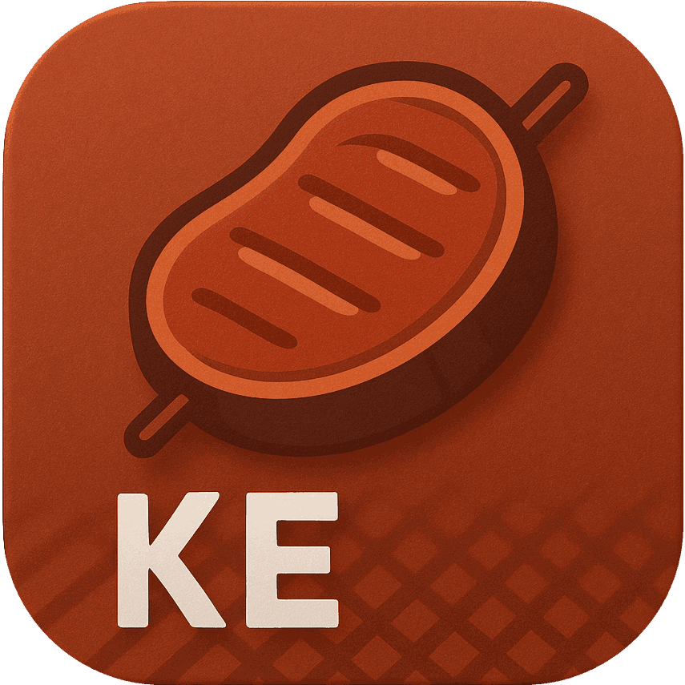

<p align="center"></p>
<p align="center">
    <a href="https://github.com/maiyun/kebab/blob/main/LICENSE">
        
    </a>
    <a href="https://www.npmjs.com/package/@maiyunnet/kebab">
        
    </a>
    <a href="https://github.com/maiyun/kebab/releases">
        
    </a>
    <a href="https://github.com/maiyun/kebab/issues">
        
    </a>
</p>

簡單，易用，功能完整開袋即食的 Node.js 框架。

> 專案聲明：本專案於 2019 年 2 月 25 日首次提交到 GitHub（前身 Mutton 框架於 2015 年 7 月 13 日首次提交，且在提交前已開發數年），於 2026 年正式引入 AI 進行輔助開發並進行 AI 適配改造，但專案依然由軟體工程師主導、審查、驗證與測試，並非許願式 AI 自動生成。非中文部分藉助柏軟翻譯進行輔助翻譯，因此語氣可能會有 AI 感。

> GitHub 的發行版本可能不全，2.0.0 之後的版本以 NPM 為準：[NPM](https://www.npmjs.com/package/@maiyunnet/kebab?activeTab=versions)

## 語言

[简体中文](README.sc.md) | [English](../README.md)

## 環境

Node.js 24+

## 安裝

執行 `npm i @maiyunnet/kebab` 安裝最新版，安裝後執行 `npx kebab init` 初始化，再執行 `npx kebab` 啟動專案。

也可以使用 pm2 啟動專案，執行 `pm2 start npx --name "kebab" -- kebab` 即可。

## 程式庫

Ai, Buffer, Captcha, Consistent, Cookie, Core, Cron, Crypto, Db (MySQL, PostgreSQL), Dns (DNSPod, Alibaba Cloud), Fs, Kv (Redis), Lan, Lang, Net, Ratelimit, S3, Scan, Session, Socket, Sql, Ssh (Shell, Sftp), Text, Time, Turnstile (Cloudflare, Tencent Cloud), Undici, Vector (Milvus), Ws, Zip, Zlib.

新的 HTTP 請求建議使用 Undici；Net 保留用於相容舊程式碼。

## 文件

- [快速開始](sc/quick-start.md)
- [游標分頁與 PostgreSQL 近似總數](sc/query-pagination.md)
- [效能監控與異常回溯](sc/monitor.md)
- [API 參考](sc/api/index.md)

## 部分特性

### 開袋即食

秉持開袋即食的原則，封裝統一風格的常用程式庫。

### 熱更新

呼叫 `lCore.sendRestart()` 發起平滑重啟：新處理程序接收連線，舊處理程序在現有連線全部結束後退出。

### 多處理程序支援

根據 CPU 核心數量建立多處理程序模型，充分提高多核心 CPU 的使用率。

### 全域連線池

同一處理程序中的不同網站若連線到同一個 Db、Kv 等伺服器，便共用同一個連線池，盡可能提高效率並減少開銷。

### 超好用 Undici 程式庫

```typescript
import * as lUndici from '@maiyunnet/kebab/lib/undici.js';

const res = await lUndici.open('https://example.com/test').post().data({ 'a': '1', 'b': '2' }).request();
const content = await res.getContent();
```

也可以這樣用：

```typescript
const res = await lUndici.get('https://example.com/test');
const content = await res.getContent();
```

只需要 JSON 回應時，使用對應的快捷方法；請求或讀取失敗回傳 `null`，JSON 解析失敗回傳 `false`：

```typescript
const data = await lUndici.getResponseJson('https://example.com/data');
```

可以設定自訂的網域名稱解析，`hostsMap` 為呼叫端提供的網域名稱與 IP 對應表：

```typescript
const res = await lUndici.get('https://example.com/test', {
    'hosts': hostsMap,
});
const content = await res.getContent();
```

也可以選擇本機的其他網路介面卡來存取，`localAddress` 為設定中的本機 IP：

```typescript
const res = await lUndici.get('https://example.com/test', {
    'local': localAddress,
});
const content = await res.getContent();
```

更有完整的 Cookie 管理器，可以將 Cookie 取得並儲存在呼叫端提供的物件中。傳送請求時，系統會根據 Cookie 的網域名稱、路徑等選擇傳送，非法跨網域的 Set-Cookie 會被捨棄：

```typescript
import * as lCookie from '@maiyunnet/kebab/lib/cookie.js';

const cookie: Record<string, lCookie.ICookie> = {};
const res1 = await lUndici.get('https://example.com/login', { 'cookie': cookie });
await res1.getContent();
const res2 = await lUndici.get('https://example.com/profile', { 'cookie': cookie });
await res2.getContent();
```

> 提示：Undici 程式庫同時支援傳入 options 和 open 鏈式操作，例如 `await lUndici.open('https://example.com/file').follow().timeout(60).save(filePath).request()`；`filePath` 為呼叫端提供的本機檔案路徑。

### 好用的 Db 程式庫

提供許多好用的介面，可以輕鬆地從資料庫篩選出需要的資料。以下控制器方法片段中，`db` 為資料庫連線池，`mOrder`、`mUser` 為應用程式定義的模型：

```typescript
const query = mOrder.where<mOrder>(db, {
    'state': '1',
}, { 'ctr': this }).by('id', 'DESC').page(10, 1);
const list = await query.all();
if (list === false) {
    return [0, 'Query failed.'];
}
const count = list.length;
const total = await query.total();
```

取得一位使用者：

```typescript
const user = await mUser.select<mUser>(db, ['id', 'user'], { 'ctr': this }).filter([
    ['time_add', '>=', '1583405134']
]).first();
```

### XSRF 檢測

依賴瀏覽器工作階段 Cookie 的資料修改介面使用 `_valibotx`，在驗證輸入時同時檢測 XSRF，防止跨網站請求偽造。頁面透過 `_enabledXsrf()` 產生 token，提交時攜帶 `_xsrf`；唯讀介面使用 `_valibot`。

### 掃碼登入

藉助 Scan 程式庫可以輕鬆實作掃碼登入功能。

### 反向代理

使用 Undici 程式庫的 `rproxy` 方法，傳入目前控制器和路由前綴對應表，即可實作反向代理功能。

#### 還有更多特性等你探索

## 程式碼示範

### 產生 16 位隨機數字字串

```typescript
import * as lCore from '@maiyunnet/kebab/lib/core.js';

const str = lCore.random(16, lCore.RANDOM_N);
```

### 產生驗證碼圖片

```typescript
import * as lCaptcha from '@maiyunnet/kebab/lib/captcha.js';

const captcha = lCaptcha.get(400, 100);
const svg = captcha.getBuffer();
const phrase = captcha.getPhrase();
```

`getBuffer()` 回傳 SVG 字串；`phrase` 為對應的驗證碼，應儲存在伺服器端並用於後續驗證。

### 取得一份清單

```typescript
const userList = await mUser.where<mUser>(db, [
    ['state', '!=', '0'],
    {
        'type': ['1', '2', '3'],
        'is_lock': '0',
    },
], { 'ctr': this }).all();
```

> 提示：查詢條件中的值透過參數綁定傳入；手寫 SQL 也應綁定使用者輸入，動態資料表名稱和欄位名稱應限制為可信值。

### Sql 程式庫自動處理資料表前綴和識別字包覆

```typescript
import * as lSql from '@maiyunnet/kebab/lib/sql.js';

const sql = lSql.get({ 'service': lSql.ESERVICE.MYSQL, 'pre': 'test' });
sql.select(['SUM(user.age) age'], 'order').leftJoin('user', { 'order.user_id': lSql.column('user.id') });
const statement = sql.getSql();
```

以下為 MySQL、資料表前綴 `test_` 的輸出；PostgreSQL 使用 schema 和雙引號：

```sql
SELECT SUM(`test_user`.`age`) AS `age` FROM `test_order` LEFT JOIN `test_user` ON `test_order`.`user_id` = `test_user`.`id`
```

### 在地化

以下控制器方法片段中，`lang` 為已驗證的語言代碼：

```typescript
if (!await this._loadLocale(lang, 'test')) {
    return 'Could not load locale.';
}
return this._l('copy');
```

根據 lang 值不同，將輸出：Copy、复制、複製、コピー等，在網站目錄 /data/locale/ 中設定。

### 資料驗證

新介面使用 Valibot 驗證字串、數字、值的範圍及正規表示式，成功後透過 `output` 取得已轉換的資料。規則放在應用程式的模組中重複使用，例如 `lib/schema/input.ts`：

```typescript
import * as lCore from '@maiyunnet/kebab/lib/core.js';

const v = lCore.v;
export const inputSchema = v.strictObject({
    'he': v.pipe(v.string(), v.nonEmpty()),
    'num': v.pipe(v.string(), v.toNumber(), v.gtValue(10)),
    'reg': v.pipe(v.string(), v.regex(/^[A-CX-Z5-7]+$/)),
    'arr': v.picklist(['a', 'x', 'hehe']),
});
```

控制器 `ctr/main.ts` 匯入規則，並在方法內驗證：

```typescript
import * as lInputSchema from '../lib/schema/input.js';

const parsed = this._valibot(lInputSchema.inputSchema, this._post);
if (!parsed.success) {
    return parsed.response;
}
return [1, parsed.output];
```

依賴瀏覽器工作階段 Cookie 的資料修改介面改用 `_valibotx`。多語言訊息與 XSRF 用法見[快速開始](sc/quick-start.md#使用-valibot-进行类型安全校验)，實際示範見 `/test/ctr-valibot`。

### 其他示範

你可以造訪 /test/ 查看更多範例。

## 授權

本框架採用 [Apache-2.0](../LICENSE) 授權。
